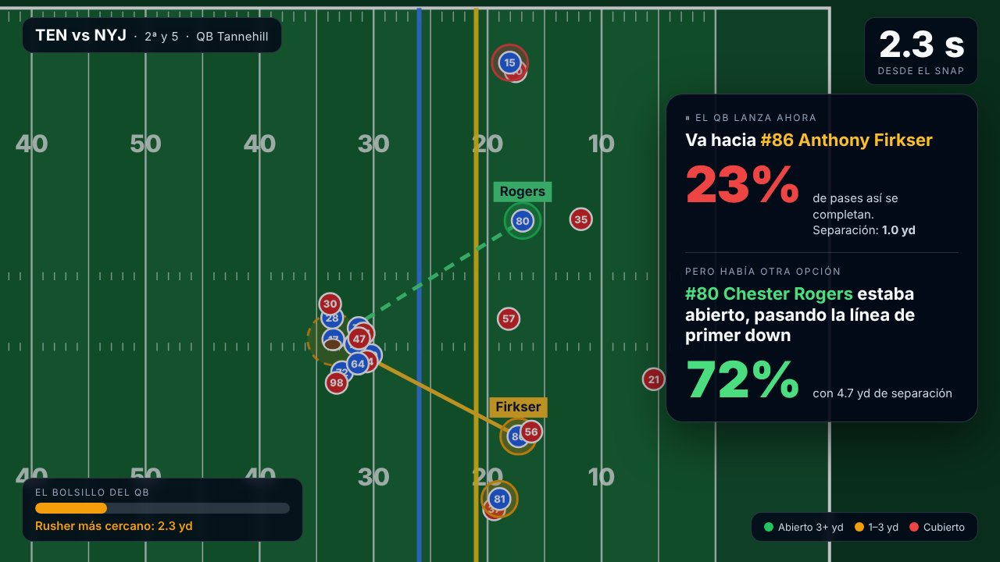
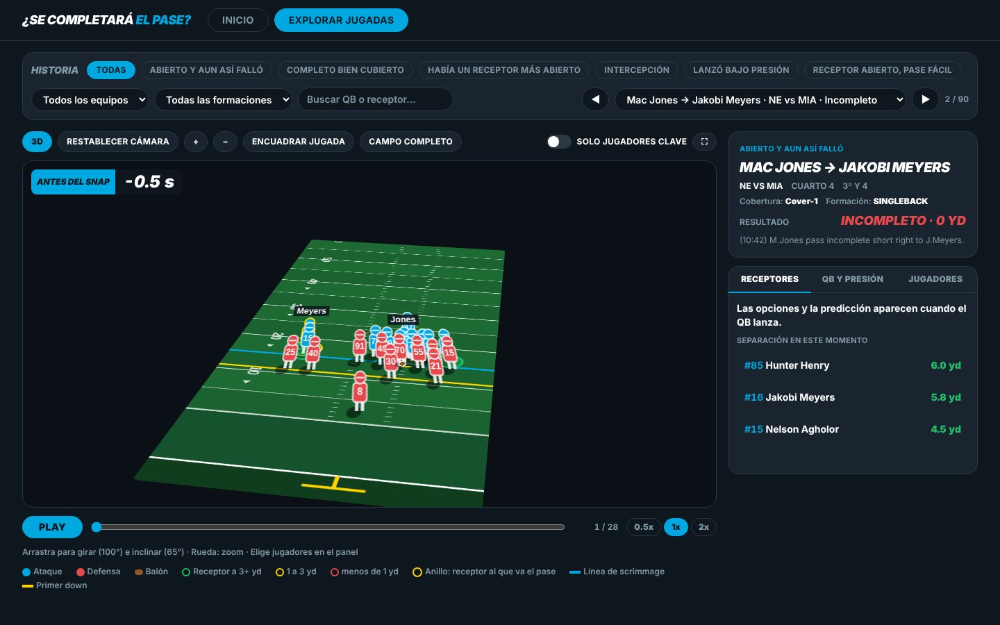

# ¿Se completará el pase?

**NFL Big Data Bowl · Sede UNAM · Equipo Data49ers**

Una app para ver una jugada de la NFL como en la transmisión y **adivinar, en el instante en que el QB suelta el balón, si el pase se va a completar**. La respuesta no sale de una caja negra: sale de una sola medida que cualquiera puede ver en el campo.



## El hallazgo

> **Entre más abierto está el receptor cuando sale el balón, más pases se completan: de 23% a 85%.**

Medimos la **separación**: la distancia entre el receptor al que va el pase y el defensor más cercano, en el cuadro exacto del lanzamiento. Lo hicimos en **7,239 pases** de las semanas 1 a 8 de la temporada 2021.

| Separación al lanzar | Pases | % completos |
|---|---:|---:|
| Menos de 1 yd | 598 | **23%** |
| 1 a 2 yd | 1,484 | 48% |
| 2 a 3 yd | 1,134 | 59% |
| 3 a 4 yd | 1,019 | 71% |
| 4 a 5 yd | 823 | 72% |
| 5 a 6 yd | 646 | 76% |
| 6 a 7 yd | 410 | 78% |
| 7 a 8 yd | 307 | 81% |
| 8 yd o más | 818 | **85%** |

Tres datos que acompañan la historia:

- **El QB no siempre elige al más abierto.** En el **29%** de los pases había otro receptor, ya pasando la línea de scrimmage, con al menos 2 yd más de separación que el elegido.
- **La presión cambia la decisión.** **6 de cada 10 presiones** ocurren cuando el QB se queda con el balón más de 3 s, y en esas jugadas **1 de cada 4 termina en captura** (8,524 jugadas de pase).
- **La formación casi no importa.** Todas las formaciones ofensivas completan entre **60% y 64%**. Lo que cambia el resultado es la separación al lanzar, no cómo se alinea el equipo.

## Cómo se muestra en la app

### Inicio
- Un video de 21 segundos con una jugada real: se ve la jugada, se pausa al lanzar, aparece la predicción y luego el resultado.
- Las cifras clave en tarjetas, la gráfica de separación contra % de completos, y la curva de cómo se cierra el bolsillo del QB según el tipo de presión.

### Explorar jugadas
- **90 jugadas reales** agrupadas en 6 historias ("Receptor abierto, pase fácil", "Completo bien cubierto", "Abierto y aun así falló", "Había un receptor más abierto", "Lanzó bajo presión" e "Intercepción"), con filtros por equipo, formación, QB o receptor.
- **Campo 2D y 3D** con los números de camiseta, la línea de scrimmage, la de primer down y un marcador como el de la transmisión. En 3D la cámara se gira e inclina con el mouse, y hay pantalla completa.
- **Semáforo de receptores:** cada receptor tiene un halo verde (3+ yd de separación), ámbar (1 a 3 yd) o rojo (cubierto) que cambia en vivo. Alrededor del QB, un círculo punteado muestra qué tan cerca está el rusher más próximo.
- **Pausa automática al lanzar:** la app dice a quién va el pase y su probabilidad, y lista **todas las opciones del QB** con su separación, su probabilidad y si pasaban la línea de primer down.
- **¿Culpa de la línea o del reloj del QB?:** cada jugada tiene un veredicto de presión ("Bolsillo limpio", "La línea no aguantó", "Rusher libre (esquema)" o "El QB retuvo el balón") y cada QB tiene su perfil de presiones.
- **Comentarista con IA (Amazon Nova):** narra el contexto del partido, lo que pasó y lo que el QB pudo hacer, y lo puede leer en voz alta.



## Caso de uso: una jugada de principio a fin

**Titans contra Jets, 2ª y 5. QB: Ryan Tannehill.** Un aficionado elige la historia "Había un receptor más abierto" y le da play.

1. **La jugada en vivo.** Corre el reloj desde el snap. Los receptores cambian de color según se abren o se cubren, y el círculo del bolsillo se va cerrando.
2. **Pausa en el lanzamiento (2.3 s).** Tannehill lanza a **#86 Anthony Firkser, cubierto a 1.0 yd**. La app muestra: **"23% de pases así se completan"**.
3. **Las opciones.** En la lista aparece **#80 Chester Rogers, abierto a 4.7 yd y pasando la línea de primer down: 72%**. Al pasar el mouse sobre él, se dibuja la línea del QB hacia Rogers.
4. **El resultado.** Le da play y el pase termina **incompleto**. La predicción se cumplió.
5. **El comentarista.** Con un clic, Nova lo narra: el contexto del partido, por qué Firkser estaba cubierto y que Rogers era la mejor opción.

El aficionado entiende en 20 segundos por qué falló el pase, sin leer una sola tabla.

## Datos y método

- **Fuente:** NFL Big Data Bowl (datos regionales del evento). Tracking de la NFL a 10 cuadros por segundo y datos de scouting de PFF. Temporada 2021, semanas 1 a 8, 122 partidos, 8,557 jugadas de pase. No usamos datos externos.
- **Receptor objetivo:** se identifica por su nombre en la descripción oficial de la jugada ("pass … to X" o "intended for X"). Así encontramos el objetivo en 7,239 pases.
- **Separación:** distancia al defensor en cobertura más cercano en el cuadro del lanzamiento, medida **antes** de saber el resultado.
- **Probabilidad:** el % de completos de los pases con la misma separación (tabla de arriba). Es una regla transparente, no un modelo opaco. Como predicción de sí o no acierta el **69%** de las veces, contra 63% de decir siempre "completo". Su valor está en el gradiente: muestra cuánto cambian las probabilidades con cada yarda.
- **Mejor opción:** el receptor con más separación que ya pasó la línea de scrimmage, si supera al elegido por 2 yd o más.
- **Presión:** hubo presión si PFF marca golpe, prisa o captura. "La línea no aguantó" es presión con culpa de PFF a un liniero y lanzamiento en 3.0 s o menos; "Rusher libre (esquema)", presión en 3.0 s o menos sin culpa a un liniero; y "El QB retuvo el balón", presión en jugadas de más de 3.0 s.
- **Procesamiento:** los CSV originales (826 MB) se procesaron fuera de la app con DuckDB. En `data/` solo están los resúmenes que usa la app.

## Limitaciones

- El tracking termina medio segundo después del lanzamiento, así que no medimos la trayectoria completa del balón ni dónde cayó.
- La separación no lo explica todo: la precisión del lanzamiento, el viento o una atrapada difícil no están en los datos.
- El umbral de 3.0 s para la presión es una decisión del equipo: la mitad de los QB lanzan antes de 2.7 s.
- Correlación no es causalidad: la separación se mide antes del resultado, pero eso no prueba que sea la única causa.

## Cómo correrlo

```
# backend (desde la raíz del proyecto)
.venv\Scripts\uvicorn backend.main:app --reload --port 8000

# dashboard (en otra terminal)
cd dashboard
..\.hackathon\.tools\node\npm.cmd run dev
```

Abre `http://localhost:5173`. Para el comentarista con IA, copia `.env.example` como `.env` y agrega las llaves del workshop; sin ellas, la app funciona igual y solo oculta esa función.

## Equipo

**Data49ers.** Separación al lanzar, predicción y app. Análisis de presión ("¿culpa de la línea o del reloj del QB?"):. Hecho con Kiro, Amazon Nova.

## Integrantes
- Saul Casas Lorenzo
- Jose Emmanuel Islas Romero
